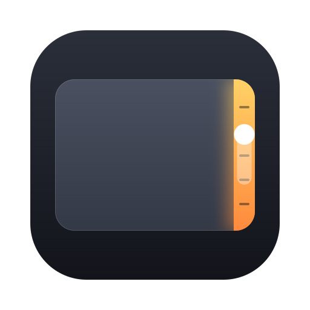

<p align="center"></p>
<h1 align="center">Sidle</h1>
<p align="center"><b>Your trackpad has edges. Use them.</b><br>
Volume, brightness and media seek on the edges of your Mac trackpad, and buttons in its corners.<br>
Free and open source. No account, no license key.</p>
<p align="center">
<a href="https://github.com/rp6186030/sidle/releases/latest">Download</a> ·
<a href="https://buymeacoffee.com/rp6186060x">☕️ Buy me a coffee</a>
</p>

| Where you press | What happens |
|---|---|
| **Right edge**, click and slide | System volume, with the normal macOS indicator |
| **Left edge**, click and slide | Display brightness (built-in display) |
| **Bottom edge**, click, slide sideways, release | Seek the video or song, with a live "+15 s" preview |
| **Top corners**, 1 to 4 clicks | Mute, open or hide an app, open a link or folder, press a keyboard shortcut, run a Shortcut, play/pause, Mission Control, lock screen |

The middle of the trackpad works exactly as before. A gesture starts only when one finger rests in an edge strip **and** you physically click, so palms, typing and scrolling never trigger it. Leaving the strip cancels. The pointer stays put while you slide. Hold ⇧⌥ for quarter steps. Every step gives a haptic tick.

## Install

**Homebrew**

```bash
brew install --cask rp6186030/sidle/sidle
```

**Manual:** download `Sidle-x.y.z.zip` from [Releases](https://github.com/rp6186030/sidle/releases/latest), unzip, and move `Sidle.app` to Applications.

### First launch

Sidle is not notarized, because that requires a paid Apple Developer account. macOS will refuse to open it the first time. Either run this once:

```bash
xattr -dr com.apple.quarantine /Applications/Sidle.app
```

or try to open it, then go to **System Settings → Privacy & Security** and click **Open Anyway**.

Then grant **Accessibility** when Sidle asks. It needs this to press the volume and brightness keys for you and to keep edge clicks out of other apps. Sidle never records what you type, and touches never leave your Mac. The only network request is a once-a-day check of this repository's latest release.

## Settings

Click the menu bar icon → **Settings…** to choose what each edge does, swap sides, set edge width and sensitivity in millimetres, require a modifier key, limit slides to the bottom quarter, and assign corner actions.

## Requirements

macOS 14 or later, built-in Force Touch trackpad or Magic Trackpad.

## Build from source

```bash
./build.sh
open dist/Sidle.app
```

Needs Xcode command line tools. See [CONTRIBUTING.md](CONTRIBUTING.md) for the architecture and how to debug the raw touch stream.

## FAQ

**Why isn't it on the Mac App Store?** Sidle reads finger positions through Apple's private MultitouchSupport framework, which App Store apps may not use.

**Does it work with an external mouse?** Mouse clicks pass through untouched. Sidle only acts when a finger is resting on a trackpad edge at the moment of the click.

**Seek moves the wrong amount.** Seek sends ← and → key presses, which most players map to 5 seconds. Change "Seconds per seek step" in Settings to match your player so the preview is right.

## Licence

MIT. If Sidle saves you a reach for the keyboard, [buy me a coffee](https://buymeacoffee.com/rp6186060x).
